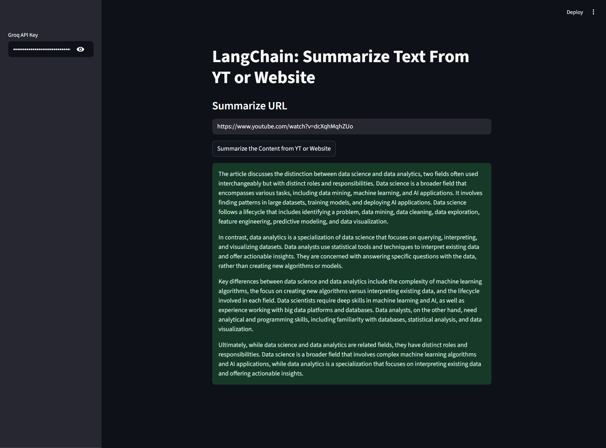
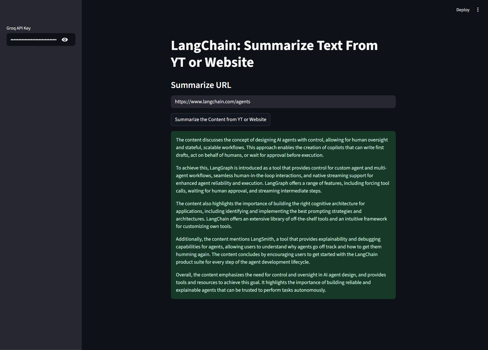

# LangChain: Summarize Text from YouTube or Website

## Project Overview
This project is a **Streamlit-based web application** that leverages **LangChain**, **Groq's ChatGroq API**, and various document loaders to summarize content from **YouTube videos** or **websites**. Users can input a URL and receive a concise 300-word summary of the content. This tool is designed for **knowledge extraction, content summarization, and productivity enhancement**.

## Key Features
- Summarizes content from **YouTube videos** or **any valid web URL**.
- Uses **Groq LLM** (`llama-3.1-8b-instant`) for high-quality summaries.
- Provides a clean, interactive **Streamlit interface**.
- Supports automatic **URL validation** and error handling.
- Easily extendable to other **document sources**.

## Technologies and Tools
- **Streamlit** – For building the interactive web application.
- **LangChain Classic** – Prompt templates and summarization chains.
- **LangChain Groq (`ChatGroq`)** – Connects to Groq API for LLM inference.
- **LangChain Community Loaders**:
  - `YoutubeLoader` – Extracts transcripts from YouTube videos.
  - `UnstructuredURLLoader` – Loads web page content.
- **Validators** – Validates URLs before processing.

---

## 📸 Application Screenshots (Streamlit UI)

